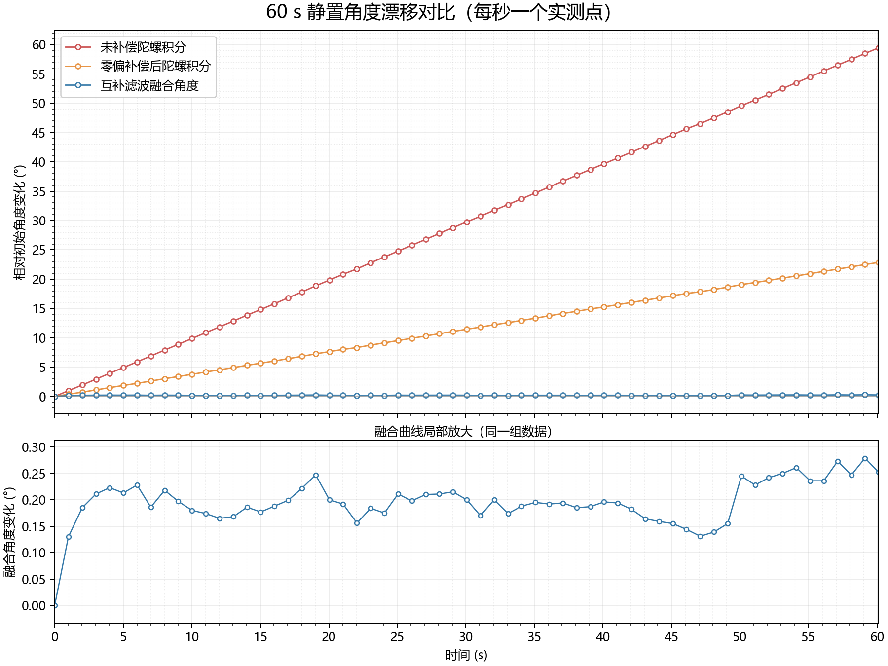

# M4-2：编码器测速、MPU6050 读取与俯仰角融合

## 任务目标与台架说明

本任务用 STM32F103C8T6 独立验证编码器测速和 MPU6050 数据处理。当前测试是桌面台架上的独立模块实验，不是装在完整小车上的测试。

任务分为：编码器测速、MPU6050 的 I²C 读取和单位换算、俯仰角互补滤波、60 秒静置漂移对比、串口实时曲线的毛刺观察，以及可从命令行运行的离线解算脚本。

## 硬件、接口与当前固件参数

| 项目 | 当前设置或记录 |
|---|---|
| MCU | STM32F103C8T6 |
| 编码器 | TIM2 硬件正交编码器模式，PA0/TIM2_CH1、PA1/TIM2_CH2 |
| MPU6050 | I²C1，PB6/SCL、PB7/SDA，模块 AD0 接低电平时地址为 0x68 |
| I²C 时钟 | 100 kHz |
| MPU6050 量程 | 加速度 ±2 g；陀螺仪 ±250 °/s |
| IMU 更新间隔 | 10 ms，目标采样率 100 Hz |
| 普通串口文本输出 | 100 ms 一次，约 10 行/秒 |
| 60 秒漂移记录 | 每约 1 秒一行；一份完整 CSV 有 61 行（起始行加 60 秒记录） |
| 串口 | USART1，PA9/TX、PA10/RX，115200 baud，8 数据位、无校验、1 停止位（8N1） |
| 调试与查看 | Keil μVision、ST-Link V2、USB-TTL/CH340、SSCOM；实时曲线测试使用 VOFA+ |

USB-TTL 串口号会随 USB 接口和电脑变化，使用前在设备管理器确认 CH340 当前的 COM 号。ST-Link 用于下载调试，USB-TTL 用于查看 USART1 串口数据。

## 2.1 编码器测速

### 做了什么

TIM2 配置成 TI12 正交编码器模式，由硬件读取 PA0、PA1 两路相位信号。程序约每 1 秒读取一次计数器，用新旧计数器的差值计算该时间窗内的计数变化 CNT，并通过串口同时输出 CNT 和 RPM。没有采用外部中断逐个统计脉冲。

静止时曾观察到 CNT:0 RPM:0.0；转动电机时，串口计数和转速会变化。电机测试使用独立 6 V 电源，不能把电机电源接到 STM32 的 3.3 V 引脚。

### 每圈计数与转速公式

商家参数给出的理论估算是：编码器磁环每圈约 7 个脉冲，正交编码器按四倍频计数，减速比 50:1：

~~~
理论输出轴每圈计数 = 7 × 4 × 50 = 1400
~~~

另一次手动计圈视频中，记录到的累计计数变化约 37,390，人工数到输出轴约 27 圈：

~~~
实测估值 = 37,390 ÷ 27 ≈ 1384.8 ≈ 1385 计数/输出轴一圈
~~~

因此 1400 是按商品参数得到的理论值，1385 是该次手动计圈得到的校准估值；27 圈是人工计数，计圈和开始、结束时刻都可能带来误差。当前编码器头文件使用 1385，不能把它描述成厂家保证的精确值。

设 ΔCNT 为一个采样窗的计数变化，Δt 为实际采样窗秒数，N=1385：

~~~
RPM = ΔCNT ÷ N ÷ Δt × 60
~~~

若窗口恰为 1 秒，则 RPM = ΔCNT ÷ 1385 × 60。例如 ΔCNT=6885 时，转速约为 298.4 RPM。代码使用实际经过时间时，应使用实测 Δt，而不是假设每个窗口绝对精确为 1 秒。

### 必须回答：1 秒窗口低速有什么问题，如何改进？

低速时 1 秒内只有少量计数，计数少一个就会产生较大的相对误差；更低速时，一个窗口可能完全没有脉冲而显示 0。改进方法是用定时器输入捕获测量相邻编码器边沿的时间间隔 Δt，再计算：

~~~
RPM = 60 ÷ (N × Δt)
~~~

低速用测周期法，高速用固定时间窗计数法；较长时间没有边沿时用超时判定转速为 0。本阶段已经实现的是 1 秒窗口的计数差法，测周期法属于改进方案，不能说已实现。

## 2.2 MPU6050 读取与物理单位换算

### 做了什么

程序启动后读取 WHO_AM_I 寄存器 0x75。日志中读到 0x68，随后输出初始化成功信息。初始化会唤醒芯片并设置量程。程序从 0x3B 开始连续读取 14 字节，解析三轴加速度、温度和三轴角速度；当前使用六轴数据，温度字节没有用于姿态计算。

当前 I²C 读取使用非阻塞完成回调：发起读取后由 I²C 完成/错误回调设置状态标志，再由主循环取样和处理。代码可输出读取错误信息。保存的 data/serial_log.DAT 中没有匹配到 I²C 读取失败信息；这表示该日志里没有记录到错误，不等于证明所有测试时刻都绝不会出错。

### 量程、系数和单位

当前量程选择为加速度 ±2 g、角速度 ±250 °/s。它适合本次桌面手持基础运动观察，并且在 MPU6050 的可选量程中较灵敏。若快速转动或冲击超过量程，读数会饱和；此时应提高量程，并同步更换换算系数。

在这两个量程下：

~~~
加速度：16384 LSB/g
ax_g = ax_raw / 16384.0
ay_g = ay_raw / 16384.0
az_g = az_raw / 16384.0

陀螺仪：131 LSB/(°/s)
gx_dps = gx_raw / 131.0
gy_dps = gy_raw / 131.0
gz_dps = gz_raw / 131.0
~~~

LSB 是芯片输出的数字计数，不是直观的加速度或角速度。换成 g 和 °/s 后，才能判断静止重力、转动速度，并把角速度乘以时间积分成角度。1 g 约等于 9.80665 m/s²。

### 必须回答：量程为什么这样选？

±2 g 和 ±250 °/s 是本次低冲击、手持观察的初始量程；较小量程能让同样的物理变化对应更多数字计数，分辨率较高。若发生量程顶格，当前量程就不合适，应改大量程并按新灵敏度换算。本次 VOFA+ 截图只画了角度和角速度曲线，没有完整原始 LSB/饱和标记，因此不能仅凭这些截图断言量程从未饱和。

### 必须回答：I²C 是多少速率，400 kHz 和 100 kHz 有什么影响？

当前 I2C1 时钟为 100 kHz。400 kHz 能缩短一次总线传输占用时间，可能降低读取对处理循环的占用；但 IMU 的目标更新间隔由 IMU_SAMPLE_PERIOD_MS=10 控制。单独把 I²C 提到 400 kHz 不会自动把采样率从 100 Hz 改高。当前使用 100 kHz 和非阻塞读取，本阶段的保存记录未显示读取失败。

### 必须回答：是否校验 WHO_AM_I？

是。程序读 WHO_AM_I，本次读数是 0x68，与 AD0 接低电平时预期身份值相符，并继续进行唤醒和量程配置。此检查能帮助区分 I²C 器件识别/接线问题与后续姿态算法问题。

## 2.3 绕 Y 轴俯仰角与互补滤波

### 坐标与角度定义

本程序把绕传感器 Y 轴的转动定义为俯仰角 pitch，陀螺仪角度积分使用校正后的 GYRO_Y。X、Y、Z 是传感器测量轴；pitch、roll 是姿态角定义。加速度俯仰公式会同时使用多个加速度轴，因此公式中出现 ACC_Z 并不意味着计算的是绕 Z 轴旋转。

### 上电零偏校准

当前滤波头文件设置 FILTER_GYRO_CALIBRATION_SAMPLES=200。程序上电后先要求传感器保持静止，采集 200 个角速度样本，逐轴求平均作为本次启动的陀螺仪零偏：

~~~
bias_x = Σ gx_dps / 200
bias_y = Σ gy_dps / 200
bias_z = Σ gz_dps / 200

gx_corrected = gx_dps - bias_x
gy_corrected = gy_dps - bias_y
gz_corrected = gz_dps - bias_z
~~~

目标采样率为 100 Hz，所以 200 个样本约需 2 秒。校准期间不要拿动传感器；这属于从当前传感器数据自动估计，不是把某次实验的零偏数值写死。温度或安装状态变化会影响零偏，启动校准时应静止。

### 角度公式

加速度计俯仰角（代码采用的坐标符号约定）：

~~~
pitch_acc = atan2(-ax_g, sqrt(ay_g² + az_g²)) × 180/π
~~~

atan2 输出弧度，乘 180/π 转为度。静止或缓慢运动时，加速度计主要测量重力方向，可提供长期角度参考；快速手动移动时，线性加速度会混入读数，因此瞬时加速度角可能出现扰动。

陀螺仪积分角：

~~~
pitch_gyro[k] = pitch_gyro[k-1] + gy_corrected_dps × dt_s
~~~

角速度单位是 °/s，乘以采样间隔秒数得到角度增量。陀螺仪短时间响应快，但剩余零偏和噪声会逐步累积。

当前固件互补滤波权重为 FILTER_COMPLEMENTARY_ALPHA=0.99：

~~~
pitch_predict = pitch_fused[k-1] + gy_corrected_dps × dt_s
pitch_fused[k] = 0.99 × pitch_predict + 0.01 × pitch_acc
~~~

0.99 表示当前更新更信任陀螺仪的短期变化，0.01 用加速度角慢慢校正长期漂移。它是本次采用的参数，不是由硬件自动得出的唯一最佳值。启动时使用加速度角作为共同的角度初值。

### 必须回答：算的是 pitch 还是 roll？Z 轴会不会影响 pitch？

算的是 pitch；陀螺积分用 Y 轴角速度。加速度角公式会使用 ax、ay、az，所以数值会受不同方向的加速度分量影响；这不改变角度定义。理想情况下做纯 X 轴横滚时，pitch 应基本保持，但手持转动不可能完全单轴，因此本次手持截图不足以量化横滚对 pitch 的串扰误差。

### 必须回答：为什么用互补滤波？

只积分陀螺仪，零偏会累积为角度漂移；只用加速度计，手部加速和振动会让重力方向估计短时不可靠。互补滤波让陀螺仪负责快速变化、加速度计负责长期校正，兼顾短期响应和长期稳定。

## 2.4 漂移实测（静置约 60 秒）

### 操作与数据

上电完成静止零偏校准后，保持传感器静止，程序以约 1 秒间隔记录一行。文件 data/static_60s.csv 有 61 行数据，时间从 0.00 s 到 60.12 s。字段包括时间、三轴加速度、三轴角速度、补偿/未补偿的陀螺积分角和融合 pitch。

这次传感器静止时初始姿态角约为 73.057°，所以角度绝对值不是从 0° 开始。漂移指标计算的是末值减初值：

~~~
漂移 Δθ = θ_last - θ_first
漂移率 (°/min) = Δθ ÷ 实际记录时长(s) × 60
~~~

实际 CSV 的起末值如下：

| 曲线 | 初值 | 60.12 s 末值 | 60.12 s 内变化 | 约漂移率 |
|---|---:|---:|---:|---:|
| 未补偿陀螺积分角 | 73.057° | 132.512° | +59.455° | +59.34°/min |
| 零偏补偿后陀螺积分角 | 73.057° | 95.913° | +22.856° | +22.82°/min |
| 互补滤波融合角 | 73.057° | 73.309° | +0.252° | +0.25°/min |

未补偿与补偿后的积分结果对比说明，上电估计零偏并逐轴扣除后，积分漂移减小但仍明显；融合结果在这次静置记录中变化最小。按这组数据，融合角相对补偿后纯积分角的绝对漂移减少约 98.9%。这是本次传感器、温度和静置条件下的结果，不是对所有运行条件的精度保证。

图：docs/plots/drift_60s_comparison.png

### 必须回答：零偏是多少，如何得到？

固件每次启动后静止采集 200 个样本，对 X/Y/Z 各轴角速度求平均作为 bias，然后从后续角速度读数中扣除。数值会随每次启动、模块温度和固定状态变化，故不应把某次 bias 当作永久常数。本次具体零偏应以对应串口日志中的 Gyro bias calibrated [dps] 行为准；已存多份日志中的数值并不完全相同。

### 必须回答：不做零偏补偿会怎样？

在同一份 60.12 秒静置 CSV 中，未补偿积分角变化 +59.455°，补偿后变化 +22.856°。这说明仅靠积分会把静止零偏累加成角度漂移；这次补偿显著降低漂移，但没有消除全部漂移。

### 必须回答：融合后的漂移主要来自哪里？

本次融合角 60.12 秒变化约 +0.252°，比纯陀螺积分小很多。剩余变化可能来自陀螺仪零偏估计误差、传感器噪声、姿态微动以及加速度校正本身的波动。仅凭这一次静置结果不能把剩余漂移唯一归因于某一项。

## 2.5 毛刺归因：实时曲线观察

### 操作与通道

使用 VOFA+ FireWater 串口连接观察实时曲线。USB-TTL/CH340 选当前设备管理器中的 COM 口，115200、8N1、无流控。此次曲线的四个数据通道定义为：

| 通道 | 数据 | 单位 |
|---|---|---|
| I0 粉色 | 加速度计算的 pitch | ° |
| I1 绿色 | Y 轴陀螺仪角速度 | °/s |
| I2 蓝色 | 纯陀螺仪积分 pitch | ° |
| I3 橙色 | 互补滤波 pitch | ° |

分别对照 I0 与 I3、I1 与 I2，避免角速度和角度在同一个纵轴上互相压缩。VOFA 曲线的横轴是滚动时间窗；负刻度表示当前时刻之前的历史，不是负的实验时间。

### 本次观察与归因

**曲线尖刺：**做了桌面静止与手动转动对比。传感器静置在桌面时，Y 轴角速度曲线只有很小起伏；手动转动时，角速度曲线出现明显尖刺。因此本次尖刺归因于手动转动过程中手部晃动和振动带来的扰动。电机没有连接，故本次不是电机振动造成的。

**转动停止后的回弹：**本次曲线未观察到明显、独立的停止后回弹现象，只看到转动后曲线逐渐回到静止附近。

**周期性小波动：**本次没有观察到稳定、重复的周期性波形。桌面静止时只有很小的起伏，不能据此称为周期性波动。

### 本次结论

桌面静止与手动转动的对比显示，明显尖刺出现在手动操作期间，因此本次将毛刺归因为手动转动造成的手部晃动/振动扰动。停止后未观察到明显回弹，曲线中也未观察到稳定周期性小波动。
## 离线复算脚本

tools/offline_solve.py 从命令行接收原始 IMU CSV，自动从文件开头检测静止段、估计这份数据自己的三轴陀螺零偏，再计算加速度 pitch、纯陀螺积分角和互补滤波角。它不把在线某次 bias 写死在脚本中。默认 pitch 轴为 Y，默认 alpha=0.99，默认静止检测角速度合成值上限为 5 °/s。

输入 CSV 至少需要以下列，单位必须一致：

~~~
t,ax,ay,az,gx,gy,gz
~~~

t 为秒，ax/ay/az 为 g，gx/gy/gz 为 °/s。也接受 t_s、ax_g、gx_dps 等别名。时间必须严格递增，文件开头需要至少 3 个连续静止样本；静止判断还要求加速度模长约在 0.80–1.20 g。脚本从第一个样本的加速度角设定角度初值，使用相邻陀螺角速度平均值积分，并按时间间隔更新互补滤波权重。

在 M4-2 目录运行：

~~~
python3 tools/offline_solve.py --input data/imu_raw.csv --out data/solved.csv
~~~

Windows PowerShell 也可运行：

~~~
python tools/offline_solve.py --input data\imu_raw.csv --out data\solved.csv
~~~

输出 CSV 至少含 t、angle_deg，还附有 gyro_only_deg 和 acc_pitch_deg；同时在输出 CSV 的同目录生成同名 .svg 曲线。可通过 --alpha、--gyro-axis 和 --still-gyro-dps 从命令行调整参数，不需要为每份考官数据改脚本。若有独立参考真值 CSV（含时间和角度列），用 --reference data\imu_truth.csv；脚本可插值对齐并计算误差。没有独立参考真值时只能展示算法曲线，不能声称通过了误差 ≤5° 的真值判定。

## 当前交付文件状态

本次检查的 M4-2 目录实际包含：

- src/main.c、src/encoder.h、src/mpu6050.h、src/filter.h
- tools/offline_solve.py
- data/static_60s.csv、data/serial_log.DAT、data/serial_log_static_2026-11-07.DAT
- docs/plots/drift_60s_comparison.png
- README.md

目录中暂未找到 encoder.c、mpu6050.c、filter.c、data/rotate_once.csv、docs/analysis.md、VOFA 手动转动曲线图片，也未找到离线解算输出 CSV/SVG。当前 src/main.c 是串口文本输出版本；本次 VOFA 截图采用的四通道 FireWater 流没有在这份 src/main.c 中体现。若考核要求以上交付物，需补齐实际的模块实现文件、手动转动数据/图、分析文档，并把最终 Keil 固件源代码同步到仓库后再作为完整交付提交。

## 整体完成情况

| 内容 | 状态 |
|---|---|
| TIM2 编码器模式、计数差和 1 秒窗 RPM | 已实现并有串口运行记录 |
| 1400 理论计数与 1385 手动计圈估值 | 已计算；1385 的测量仍带人工计圈误差 |
| MPU6050 I²C 识别、六轴读取、物理单位换算 | 已实现；日志读到 WHO_AM_I=0x68 |
| 上电 200 样本陀螺零偏校准 | 已实现；要求上电后静止等待 |
| Y 轴 pitch 的加速度估算、陀螺积分和互补滤波 | 已实现；在线 alpha=0.99，采样目标 100 Hz |
| 60 秒静置漂移 CSV 与对比图 | 已有文件并完成起末值/漂移率计算 |
| VOFA 手动转动曲线与毛刺观察 | 已完成桌面静止/手动转动对比；尖刺归因于手动操作扰动，未观察到明显回弹或稳定周期 |
| 离线复算命令行脚本 | 脚本已存在；本目录尚无解算输出和独立真值误差报告 |
| 交付目录完整性 | 尚未齐全，缺项见上方文件状态 |

